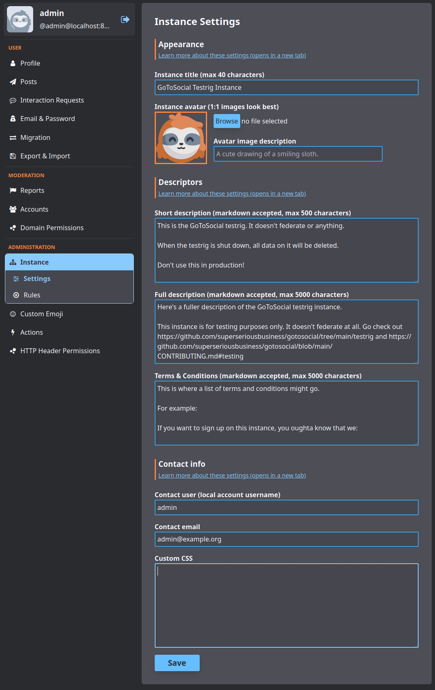

# GoToSocial

GoToSocial is a lightweight, single-binary ActivityPub server: run your
own home on the Fediverse, post from any Mastodon-compatible app
(Tusky, Phanpy, Elk, and more), and federate with Mastodon, Pleroma,
Pixelfed, and the rest — without running a heavyweight stack. One
service, one SQLite database, one volume, zero-field deploy form.

*Screenshot: GoToSocial project documentation (admin settings panel),
AGPL-3.0. Copied from upstream docs, not hotlinked.*

## First login

Deploy, wait for the service to go green, then open your instance URL
and log in at `/settings` (or any Mastodon-compatible app pointed at
your domain) with:

- **Username:** `admin`
- **Password:** the generated `GTS_ADMIN_PASSWORD` from your deploy
  (find it in the service's Variables tab)

The admin account is created automatically on first boot — GoToSocial
has no web signup for the first account, and Railway offers no
container shell, so the entrypoint boots the server briefly to
initialize the instance, then runs upstream's documented
`admin account create` + `promote` flow for you, exactly once, before
starting the server for good.
Change the password in the settings panel after first login.

## Deploy and Host

Deploying GoToSocial on Railway is one service plus one volume: the Go
binary, its SQLite database, media storage, and wazero cache all live
on `/data`. Railway terminates TLS at the edge; the app's plain HTTP
listener serves the web UI, the Mastodon-compatible API, and
ActivityPub federation. The deploy form is zero-field: the domain
resolves from Railway and the admin password is generated.

## Why Deploy

- **Your own Fediverse home.** Post, follow, and federate from a
  domain you control, with no ads, no tracking, and no algorithmic
  feed.
- **Featherweight.** A single Go binary with SQLite — roughly
  250–350 MB RAM — instead of Mastodon's multi-service stack.
- **Any client works.** The Mastodon-compatible API means Tusky,
  Phanpy, Elk, IceCubes, and dozens of other apps connect directly.
- **Safety-first defaults.** Registration is closed by default and
  new signups need admin approval when you open it, so a fresh
  instance never becomes an open relay overnight.

## Common Use Cases

- A personal single-user instance as a Mastodon alternative.
- A small private instance for friends, family, or a community.
- A quiet outpost for following the Fediverse without an account on a
  giant instance.
- A staging instance for testing federation against other software.

## Configuration

The deploy form is zero-field. Auto-wired: `GTS_HOST`
(`${{RAILWAY_PUBLIC_DOMAIN}}` — the instance domain) and
`GTS_ADMIN_PASSWORD` (`${{secret(24)}}` — the seeded admin's
password).

Baked defaults (override with service variables + redeploy):

- `GTS_DB_TYPE` (`sqlite`), `GTS_DB_ADDRESS` (`/data/sqlite.db`)
- `GTS_STORAGE_BACKEND` (`local`),
  `GTS_STORAGE_LOCAL_BASE_PATH` (`/data/storage`)
- `GTS_WAZERO_COMPILATION_CACHE` (`/data/.cache`)
- `GTS_LETSENCRYPT_ENABLED` (`false` — Railway terminates TLS),
  `GTS_PROTOCOL` (`https`)
- `GTS_ACCOUNTS_REGISTRATION_OPEN` (`false`),
  `GTS_ACCOUNTS_APPROVAL_REQUIRED` (`true`)
- `GTS_ADMIN_USERNAME` (`admin`),
  `GTS_ADMIN_EMAIL` (`admin@example.com`)
- `GTS_PORT` is derived at boot from Railway's injected `PORT`
  (fallback 8080) — never set it by hand.

Optional upstream features, all off/unset by default (set as service
variables + redeploy):

- `GTS_SMTP_HOST` / `GTS_SMTP_PORT` / `GTS_SMTP_USERNAME` /
  `GTS_SMTP_PASSWORD` / `GTS_SMTP_FROM` — email for confirmation
  mails, notifications, and password resets. Required before opening
  web signups: without SMTP, signed-up accounts cannot confirm their
  email (the seeded admin can still confirm users from the settings
  panel).
- `GTS_TRUSTED_PROXIES` — CIDR(s) of trusted reverse proxies, for
  accurate client IPs behind a proxy. Railway's edge IPs are dynamic;
  leaving this unset is functional (rate limiting just sees the
  proxy IP).
- `GTS_INSTANCE_TITLE`, `GTS_INSTANCE_SHORT_DESCRIPTION`,
  `GTS_INSTANCE_DESCRIPTION` — instance metadata shown on the
  landing page and in `/api/v1/instance` responses (also editable in
  the admin settings panel).
- `GTS_INSTANCE_LANGUAGES`, `GTS_MEDIA_REMOTE_CACHE_DAYS` — timeline
  language defaults and remote-media retention.

### Deployment Dependencies

- Railway Hobby plan or higher (one always-on service).
- Memory at rest: roughly 250–350 MB.
- One persistent volume (`/data`: SQLite database, media storage,
  wazero cache, admin-seed marker).
- No GPU, no Docker socket, no special kernel features.

## Notes for instance owners

- **Your domain is permanent.** GoToSocial bakes `GTS_HOST` into
  account URIs at first boot. Changing the domain later breaks your
  federation identity (followers, posts, and remote references all
  point at the old domain). Pick the domain before first boot and do
  not change it.
- **Web signups need SMTP.** With registration closed (the default),
  only the seeded admin exists. To let people sign up from the web,
  set `GTS_ACCOUNTS_REGISTRATION_OPEN=true` and configure the
  `GTS_SMTP_*` variables, then redeploy. With approval required
  (the default), you approve each signup from the settings panel.
- **Post from apps, not just the web.** GoToSocial's built-in web UI
  is the settings/admin panel and instance pages; for posting, use
  any Mastodon-compatible client pointed at your domain.
- **Upstream:** [GoToSocial](https://codeberg.org/superseriousbusiness/gotosocial)
  (AGPL-3.0), image `superseriousbusiness/gotosocial:0.22.3`
  pinned by digest in the Dockerfile.
