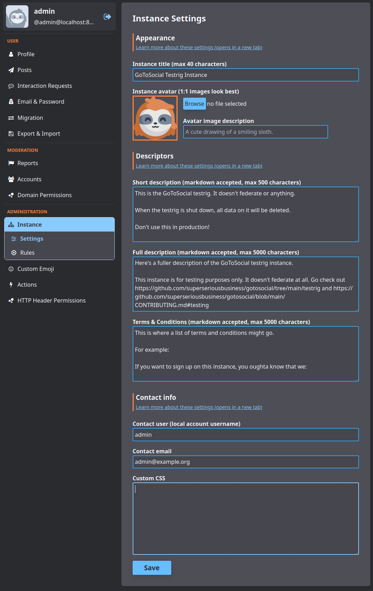

# Deploy and Host

GoToSocial is a lightweight, single-binary ActivityPub server: your
own home on the Fediverse, posting from any Mastodon-compatible app,
federating with Mastodon, Pleroma, Pixelfed, and the rest. Deploy it
on Railway in one click: one service, one SQLite database, one
volume, and a zero-field deploy form. The first admin account is
seeded automatically on first boot — log in with `admin` and the
generated password, then change it in the settings panel.

## About Hosting

Hosting GoToSocial on Railway means a single Go service with its
SQLite database, media storage, and wazero cache on one persistent
volume at `/data`. The wrapper runs as root (the upstream image's
1000:1000 user cannot write Railway's root-owned volume), maps
Railway's injected PORT to GoToSocial's listen port at boot, derives
the instance domain from the Railway public domain, and seeds the
first admin via upstream's documented CLI flow before the server ever
starts. Railway terminates TLS at the edge; the app's plain HTTP
listener serves the web UI, the Mastodon API, and federation traffic.
Restarts and redeploys keep every account, post, and media file
through the volume.

## Why Deploy

- **Your own Fediverse home.** Post, follow, and federate from a
  domain you control — no ads, no tracking, no algorithmic feed.
- **Featherweight.** One Go binary with SQLite (~250–350 MB RAM)
  instead of a multi-service stack.
- **Any client works.** The Mastodon-compatible API connects Tusky,
  Phanpy, Elk, IceCubes, and dozens of other apps directly.
- **Safety-first defaults.** Registration closed and approval
  required out of the box, so a fresh instance never becomes an open
  relay overnight.

## Common Use Cases

- A personal single-user instance as a Mastodon alternative.
- A small private instance for friends, family, or a community.
- A quiet outpost for following the Fediverse without an account on
  a giant instance.
- A staging instance for testing federation against other software.

## Dependencies for

GoToSocial needs exactly one service: the app itself, with SQLite.
There are no companions, no workers, and no cache service in the
default deploy — SMTP is the only opt-in extra, and only for email
confirmation, notifications, and password resets.

### Deployment Dependencies

- Railway Hobby plan or higher (one always-on service).
- Memory at rest: roughly 250–350 MB.
- One persistent volume (`/data`: SQLite database, media storage,
  wazero cache, admin-seed marker).
- No GPU, no Docker socket, no special kernel features.

## Configuration (condensed)

The deploy form is zero-field. Auto-wired: `GTS_HOST`
(`${{RAILWAY_PUBLIC_DOMAIN}}`, permanent federation identity) and
`GTS_ADMIN_PASSWORD` (`${{secret(24)}}`, seeded admin password).
Baked defaults: `GTS_DB_TYPE` (`sqlite`), `GTS_DB_ADDRESS`
(`/data/sqlite.db`), `GTS_STORAGE_BACKEND` (`local`),
`GTS_STORAGE_LOCAL_BASE_PATH` (`/data/storage`),
`GTS_WAZERO_COMPILATION_CACHE` (`/data/.cache`),
`GTS_LETSENCRYPT_ENABLED` (`false`), `GTS_PROTOCOL` (`https`),
`GTS_ACCOUNTS_REGISTRATION_OPEN` (`false`),
`GTS_ACCOUNTS_APPROVAL_REQUIRED` (`true`),
`GTS_ADMIN_USERNAME` (`admin`), `GTS_ADMIN_EMAIL`
(`admin@example.com`); `GTS_PORT` derives from Railway's `PORT` at
boot. Optional post-install (service variables + redeploy):
`GTS_SMTP_*` (email; required before opening web signups),
`GTS_TRUSTED_PROXIES`, `GTS_INSTANCE_TITLE` /
`GTS_INSTANCE_SHORT_DESCRIPTION` / `GTS_INSTANCE_DESCRIPTION`,
`GTS_INSTANCE_LANGUAGES`, `GTS_MEDIA_REMOTE_CACHE_DAYS`.
Full descriptions live in the repo README.
